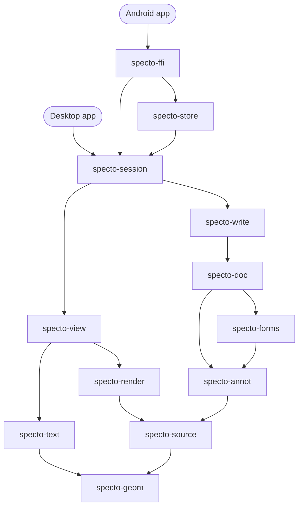

# Crates

The shared core of Specto. Both apps are built on these crates, and none of
them depends on a UI toolkit.

An arrow points from a crate to one it depends on. Indirect dependencies are
left out: the session also uses the text layer directly, for example.

## specto-geom

Typed coordinate spaces, so that PDF points, page coordinates and device pixels
can't be mixed up. It also holds the geometry of a page: its crop box and
rotation.

## specto-source

Opens and decrypts PDF files, and reads their structure: metadata, the table of
contents, links and page labels.

## specto-render

Renders pages into tiles with hayro. Rendering happens on background threads,
and finished tiles are kept in a cache.

## specto-text

The text on each page with its position, grouped into words and lines.
Selection, copy and search build on it.

## specto-annot

Annotations such as highlights: the data model, reading the ones a file already
has, and how they are drawn.

## specto-forms

The form of a file: its fields with their kind, value and flags, and where each
shows on the pages.

## specto-doc

The document being edited: its list of pages, the changes made to its
annotations and what was filled into its form, with undo and redo. The files it
came from are never modified.

## specto-view

The viewer: page layout, zoom, scrolling, text selection and search results.
For each frame it decides which tiles to draw where, and which to render next.

## specto-write

Saves an edited document as a new PDF, with lopdf.

## specto-session

An open document as the apps hold it: the files, the edited pages, the viewer,
the text, the selection and the search. It ties the other crates together.

## specto-store

What the apps keep on disk between runs: drafts of documents with unsaved
edits, and the images of stamps they use.

## specto-ffi

The bindings for the Android app, through UniFFI and JNI. The desktop app is
written in Rust and uses the session directly.

## More

How the crates work together is described in
[docs/ARCHITECTURE.md](../docs/ARCHITECTURE.md).
