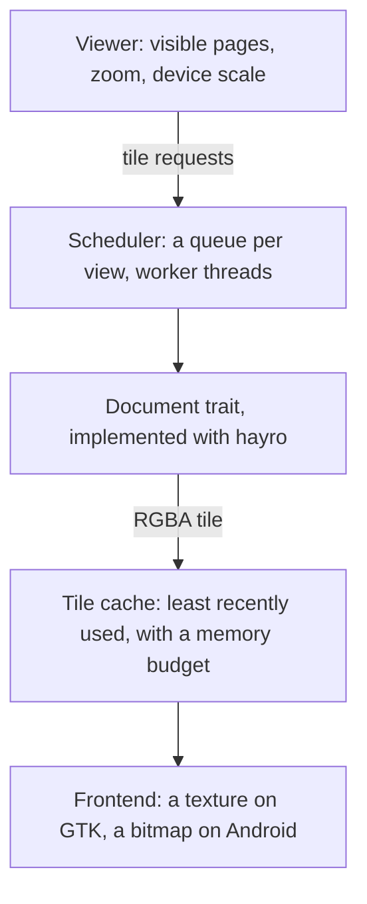

# Architecture

How Specto is put together. What each crate does, and how they depend on each
other, is in [crates/README.md](../crates/README.md). Everything here describes
what exists, except the last section, which lists what is planned.

## Guiding principles

1. **All logic lives in Rust, and the frontends are thin.** Anything other than
   drawing pixels, receiving input and showing native widgets belongs in a
   shared crate. That includes the layout of the viewing modes, hit-testing,
   the logic of the markup tools, and undo and redo. A second frontend should
   then cost weeks, not months.
2. **The source PDF is not changed while editing.** An open document is an edit
   model layered over immutable source files, and bytes are only produced on
   save. This keeps rendering fast, because nothing is parsed again after an
   edit, and makes undo simple.
3. **Rendering sits behind a trait.** The pure-Rust ecosystem is young, and we
   want to be able to swap or compare renderers, for example with PDFium as a
   reference in tests. Reading the file, extracting text and saving use hayro's
   parser and lopdf directly.
4. **Coordinates are always explicit.** PDF user space (points, y up, with the
   page's rotation and crop box), page space, document layout space and device
   pixels are different things, and each has its own type.

## File data

The source crate holds a file's bytes in a type called `PdfData`, shared
between threads. hayro needs the whole file as one slice. Files under 64 MB are
read into memory. Larger ones are memory-mapped, so they open at once and only
the parts in use take memory.

A mapped file must not be truncated while it is open, because reading the
missing part crashes the process. Saving therefore always writes a new file and
renames it into place, and never writes over the open file. Another program
truncating a mapped file in place can still crash the app.

On Android, the file arrives as a file descriptor from the Storage Access
Framework and is read or mapped the same way. A pipe, which some document
providers hand out, is read.

The desktop app watches the open file and keeps a fingerprint of it (its entity
tag and size) from when it was read or last saved. A change that doesn't match
the fingerprint came from another program. An unedited document is then
reloaded in place, and an edited one gets a banner offering to reload. Saving
checks the fingerprint once more and asks before overwriting.

## Data model

Each app holds one session per open document. A session has:

- The sources: the parsed PDF files its pages come from, one per file opened or
  inserted from. They are never changed.
- The edit document, which holds:
  - The page list, in the order the user sees. Each entry names a source, a
    page of it, and the rotation the user added.
  - The annotation edits: which annotations of the files were deleted or
    changed, and the new ones.
  - The undo and redo history: earlier states, each with the edit that changed
    it.

Why this shape:

- **Deleting, reordering, rotating and inserting pages** are edits to the page
  list. Inserting pages of another PDF adds a source and splices its pages in.
  Nothing is parsed or rendered again except what becomes newly visible.
- **Sources** each have their own scheduler document, parsed file, page
  geometries, links and search text. The first is the file that was opened,
  whose outline the document shows. Sources stay open while undo can bring
  their pages back.
- **Page labels** stay with their pages. Each page keeps the label it has in
  its file, and pages of files without labels are numbered by position.
- **Pages copied between documents**, by dragging between windows, come as a
  bundle of the files' data and the pages with their rotation. The data is
  shared, not copied.
- **Undo and redo** keep a copy of the page list from before each edit. That is
  12 bytes a page, so 120 KB a step for 10,000 pages, and 100 steps are kept.
  Undo can't drift out of step with redo, as hand-written inverse commands can.
  Each step records what the edit was, which the frontends name in their menus
  ("Undo Rotate Page").
- **Modified** compares a version number of the current state with the one last
  saved, so undoing back to the saved state counts as unmodified.
- **Positions and file pages** are kept apart. The viewer, selections and
  search results work with positions in the edited list. What doesn't change
  with editing (text layers, search text, links, outline destinations) is keyed
  by the file and its page, and mapped to its current position when needed. A
  link's destination is looked up in the file the link is in.

### Annotations

An annotation is plain data: its kind, rectangle, color, opacity, line width,
author, text and modification date. The kinds are text markup (highlight,
underline, strikethrough), ink, square, circle, line, note, text box and stamp.
Any other kind is kept by its subtype, shown as the file draws it, and can be
deleted but not changed.

Annotations are in the coordinates of their page of the file, so rotating or
moving the page doesn't touch them. The markup a page has is read when the page
is first asked for. Links, form fields, popups and media aren't markup and are
left out, and saving leaves them alone.

The edit document doesn't hold the annotations, only what was done to them
relative to the files. That is small whatever the files contain, costs nothing
for pages nobody looked at, and is what saving needs. It is kept per undo step,
shared until it changes, so page and annotation edits are undone in the order
they were made. Annotations belong to a page of a file, not to a position. They
follow the page, come back with it when its deletion is undone, and copies of
one page share them.

**Drawing.** The annotation crate turns an annotation into a few shapes (filled
quads, lines, paths). It also writes those shapes as the appearance stream
saved with the annotation, because many viewers show only that. Who draws an
annotation on screen depends on whether the file has such a stream for it:

- The annotations of a file are part of the page tiles. hayro draws them from
  their appearance streams.
- The apps draw the rest over the page, from the same shapes. That covers
  annotations made in the session, and ones the file gives no appearance for. A
  highlight darkens what is beneath it through the toolkit's multiply blend. A
  test saves a file and renders it with hayro to check that the two agree.

**Page variants.** hayro draws all of a page's annotations or none. So when an
annotation of a file is deleted, its page is rendered from a variant: a copy of
that one page without the annotation, written by the write crate exactly as
saving would, and opened as a scheduler document of its own. Only the tiles
come from the copy. Text, links, search and saving still use the file. Undo
closes the copy and goes back to the file. A page whose copy can't be written
keeps its annotation, and the app says so.

The same happens when an annotation of a file is changed: the copy leaves it
out, and the app draws it from then on. Specto marks the appearance streams it
writes, so after a file is reopened it knows which annotations it can draw anew
without losing detail. For annotations from other programs, only text markup
can be changed.

Thumbnails draw the same overlay, scaled. Printing renders pages from their
files on a thread of its own, and renders a page with edited annotations from a
variant with all the changes in it. Pages copied to another window take the
changes to their annotations along.

**Tools.** Marking the selected text, drawing a new annotation, picking one,
and moving or resizing it are implemented in the session. The frontend passes
on pointer positions and keeps track of which tool is chosen.

**Saving.** A changed or deleted annotation of a file is named by its position
in the page's annotation array and its object number. Saving checks that lopdf
finds the same object there before touching it.

### Forms

The forms crate reads the form of a file (AcroForm only): each field with its
kind, value and flags, and its widgets with their page and rectangle.
Attributes a field inherits from its parents are resolved while reading. Text
fields, checkboxes, radio buttons, menus and lists can be filled in. Other
kinds are read and shown as the file draws them. A field also says what it
holds at first, which is what resetting the form sets it to, as one edit.

Like annotations, the edit document holds only what differs from the file: a
value per field that was filled in, kept per undo step. A field set back to
what the file has leaves nothing to save. Only the form of the opened file
counts. Inserted pages bring their widgets along, but not their form.

A field shows through the appearance streams of its widgets, which hayro draws
with the page. So a page with a filled-in field is rendered from a page variant
too, with the values written into it exactly as saving would. For a checkbox or
a radio button that selects one of the looks the file has. For a text field the
write crate makes a new look from the field's font, size, color and alignment.
A menu gets the same with the chosen option or the text typed for it, and a
list shows its options with the chosen ones marked. A comb field gets each
letter in the middle of its cell. A widget that says it is turned, as on a
landscape page, gets its look turned the same way.

Some files hold text for a field without a look that shows it, and ask the
reader to make one (`/NeedAppearances`). The forms crate marks such a field,
and the session shows its pages from a variant from the start, with the looks
made from the values of the file.

A text field is typed into through a text input of the toolkit, placed over the
widget. Meanwhile the variant shows the field empty. The session says where the
input goes and in which font and size, and takes the text when typing ends. For
a comb field the frontend gives each letter the room that makes it as wide as
a cell, so that it stands where the saved look has it.

The session also keeps which field has the keyboard, and the order Tab goes
through the fields in: by page, and on a page as its annotation array lists
them, or by rows or columns of their places if the page asks for that
(`/Tabs`). The frontend passes the keys on and draws a frame around the field.

## Rendering pipeline

- **Tiles** are 512 by 512 physical pixels, so zooming far into a poster
  doesn't allocate a 100-megapixel bitmap. A tile is identified by its
  document, page, rotation, content (with or without annotations), scale and
  position.
- **The scheduler** gives each view a queue of its own, which the view replaces
  every frame, and serves the queues in turn. The desktop shares one scheduler
  between its windows, and Android has one per document.
- **Expensive pages** are guarded against, because hayro can't be cancelled.
  Pages with more than 100 megapixels of images, or a render that takes more
  than half a second, render one tile at a time. Extra worker threads start
  while renders are stalled.
- **HiDPI.** The device scale factor is multiplied into the render scale, and
  tiles are rendered at physical pixels. A settled view is drawn from tiles at
  the exact device scale, one to one, so it is pixel-identical to a direct
  render at that scale. This was measured on macOS at scale 2 and on Linux at
  1.25, 1.5 and 2.
- **Zoom.** While zooming, tiles come from zoom levels a factor of √2 apart,
  rendered at or above the device scale and downsampled. Continuous zooming
  then reuses a few cached levels instead of rendering every zoom in between.
  Once the zoom has been still for 250 ms and no pinch is in progress, the
  viewer switches to exact-scale tiles, with level tiles as a fallback until
  they arrive. This is the blurry-then-sharp behavior Preview has.
- **GTK pitfalls.** Tiles must be drawn with `append_texture`, not
  `append_scaled_texture`, which GSK renders at logical resolution on HiDPI
  surfaces. The canvas must also be translated so that its origin lands on a
  whole device pixel of the surface, because window shadows can put it at a
  fractional one.
- **Thumbnails** draw the viewer's placeholder tiles, one small tile per page,
  from the shared cache. Each page is then rendered once for both the sidebar
  and the canvas.
- **Annotations** drawn by the apps are an overlay over the page tiles, so
  editing them never renders page content again.

## Text layer

The text crate implements hayro's device interface to collect glyphs with their
Unicode mapping and their position. It then groups them into words and lines,
in the order of the content stream. This is the basis for:

- text selection, from a point to a character to a range to its highlight
- copying to the clipboard
- search, with the position of each match
- text markup, which needs the position of the marked text

## The open document

The session is what both apps mean by an open document. It holds:

- the files its pages come from
- the edit document and the viewer
- the text layer with its cache, and the selection
- the search, with its background indexer
- links and page labels
- what saving needs

Edits go through the session, which then updates everything that holds page
positions: the viewer's pages, the labels, the selection (dropped) and the
search (run again). What doesn't change with editing is cached by page of the
file, not by position.

The session has no toolkit, no pixels, and no threads of its own apart from the
search indexer. A frontend adds what differs between the apps:

- **Tiles.** The desktop keeps GTK textures in a tile cache. Android keeps the
  ids of bitmaps that Kotlin owns. Each asks the viewer for a frame and
  requests the tiles itself.
- **The scheduler.** The session doesn't own it, because the desktop shares one
  between windows. Opening and closing a session take it as an argument.
- **Callbacks.** The indexer hands each page's search text to a closure the
  frontend supplies, on the indexer's thread. The desktop sends it through a
  channel to the main loop, and Android locks the session where it is.
- **Threads.** The desktop holds its session on the main thread. Android holds
  it in a mutex, since Kotlin calls from several threads.

Trimmed margins are a crop of each page's geometry, to the box of what the page
draws with a little room around it. The box comes from interpreting the page's
content without rasterizing it. What is drawn in white counts as nothing, and
so does what is clipped away. A page is measured when it is about to be shown,
with the two pages before and after the current spread, on the frontend's
thread like the text layer: a fraction of a millisecond for most pages. Only
the layouts of single pages and pairs show pages trimmed, since they fit each
spread to the window on its own and a page may have any size. The continuous
layouts show pages whole, so nothing measures a whole document. The crop is
part of the tile key, so the render workers draw the same part of the page that
the viewer lays out, and hit-testing, selection and annotations follow from the
geometry. Thumbnails show pages whole. A scan is one image across the whole
page, so it isn't trimmed.

## The viewer

The viewer is state without a UI that both frontends drive. It owns layout,
zoom, scrolling, hit-testing, the text selection and the search results. For
each frame it tells the frontend which cached tiles to draw where, which tiles
to request, and when to redraw.

- **Margins and gaps are constant in logical pixels**, like Preview, so layout
  is computed again on zoom changes, which takes microseconds. Zoom anchoring
  tracks a point within a spread in PDF points, plus any offset into the margin
  in pixels, so the content under the pointer stays put.
- **Everything the frontend draws is in device pixels**, snapped so that page
  origins are whole pixels. A tile rendered at exactly the device scale is
  drawn one to one, without filtering.
- **Layers per page.** First a one-tile placeholder, then cached tiles from
  neighboring zoom levels wherever sharp tiles are missing, then sharp tiles.
  Zooming therefore shows the previous level's tiles instead of the blurry
  placeholder.
- **Settling** is decided in the viewer, driven by the frontend's clock. The
  frame says when the view will settle, so the frontend knows when to redraw.
  Exact tiles are never requested during a pinch or right after a scroll-zoom
  step, so the zooms in between don't churn the cache.
- **Request order.** Visible placeholders come first, then visible sharp tiles,
  then the placeholders of neighboring pages, then a band of half a viewport
  above and below.
- **Tile keys are plain data**, integers only: the scale in fixed point, and a
  page's crop in hundredths of a point. Page rectangles are sized from the
  same quantized scale, so exact tiles always map one to one.
- **Text pages** are supplied through a trait, so the viewer doesn't decide how
  they are cached. The session caches them by page of the file.
- **Swipe paging**, used on Android. In the paged layouts all spreads are laid
  out side by side, each centered in a slot at least as large as the viewport
  and fitted to it on its own, so pages of different sizes each fill the
  screen. The viewer tells the frontend where the view should come to rest
  after a drag: a flick, or more than half way, turns the page. Vertical
  scrolling and the zoom anchor belong to the current spread, and the
  neighbors' tiles are prepared at their own exact scale.

## Saving

Saving writes the document with lopdf, in one of two ways. Annotations are
saved as standard PDF annotations, never flattened into page content, as Preview
does (see D8 in [DECISIONS.md](DECISIONS.md)).

**Appending.** Where a save only adds to the file, the file is kept as it is
and the objects that changed are appended to it, with a new cross-reference
section. That is the case when the pages are untouched and all that was done is
adding annotations and filling in fields that were empty. It is several times
faster than a rewrite, and a digital signature over the file stays valid,
because the bytes it covers don't change.

A save that deletes or changes something the file holds is never appended: the
old annotation or value would stay in the file for someone to dig out. Neither
is a file that lopdf had to repair to read. Those saves rewrite the document.

**Rewriting.** Everything else is a full rewrite, described below.

The result is written to a temporary file and renamed into place, keeping the
file's permissions and following symbolic links. The file that was renamed over
stays readable through an open mapping, so the document doesn't need opening
again after a save. Its edits stay relative to the original data, and saving
again writes the same result. An appended save is therefore always the file as
it was opened plus one update, however often it is saved, and an annotation
that was saved and then deleted is gone from the next save.

Encrypted documents keep their security handler, password and permissions. The
rewrite encrypts the result again with the same settings, including pages that
came from other files.

How the rewrite works:

- lopdf loads and decrypts the main source. Inherited page attributes are
  pushed down onto each page, the page tree becomes one flat list of the pages
  kept, and each page's rotation gets the user's rotation added.
- Deleted pages are removed. References to them, from outline entries and
  links, dangle, which readers treat as null.
- Page labels stay as they are while every page is still there, in order.
  Otherwise new ones are written, in which each page keeps the label it had in
  its file.
- A page used twice gets its own page dictionary and copies of its annotations.
  Pages from other sources are copied in and renumbered.
- lopdf loses some data that hayro recovers: the contents of streams without a
  valid length, and of streams it decrypts wrongly. Every stream's bytes are
  compared with hayro's reading of the same object, and hayro's version is
  used, so the saved file has what the app showed.
- After writing, the result is read back with hayro, and each page is compared
  with its source page. Any difference fails the save instead of writing a
  damaged file.

On the corpus, 1,066 of 1,077 files are rewritten with every page rendering
identically, both unchanged and with pages reversed and rotated. The other 11
are refused, nearly all of them damaged files that lopdf can't read. None is
written damaged.

## Drafts

The Android app keeps unsaved edits on disk as a draft, so that they are back
when the document is next opened after the app was ended. The desktop app
doesn't keep drafts. A draft holds what was done
and not the history of how: the page list, the annotation edits and what was
filled into the form. Undo starts afresh from there. The files pages were
inserted from are kept with it.

The edit model is serialized with serde, as JSON. The store (specto-store) is a
directory with a directory for each draft, named by a digest of its key, and
the images of stamps, named by a digest of their pixels and kept once however
many drafts use them. Each file is written beside its place and renamed into
it. Drafts that weren't written or opened for a while, and the images no draft
names, are deleted.

The key names the document and the fingerprint says which file the draft was
made of: a draft of a file that changed since is not used. A document with a
password gets no draft, as it would keep what was typed into it unprotected.

An app update ends the app, often with a draft waiting, so later versions read
the drafts of earlier ones. The edits are stored in a variant of an enum for
each format. A change to the edit model that old drafts can't be read as adds a
variant, with the types as they were and a conversion, and a test reads a
stored draft of every format there was.

## Frontends

### Desktop

The desktop app uses GTK 4 and libadwaita through gtk4-rs. It targets Linux
first and also runs on macOS with Homebrew's GTK. It uses the shared crates
directly.

The page view is a custom scrollable widget that draws each frame's tiles as
textures. The rest of the window uses stock widgets: a split view with a list
of thumbnails and a tree for the outline, the file dialog, and the zoom gesture
for touchpad pinch. Printing uses GTK's print operation, with pages rendered at
300 dpi on a thread of their own.

The sidebar is also the page organizer: thumbnails can be selected and dragged
within it, and PDFs can be dropped on it to insert them.

### Android

The Android app is written in Kotlin with Jetpack Compose.

- The FFI crate exposes a coarse API through UniFFI, over the same session as
  on the desktop. It avoids chatty calls across the boundary.
- The work done on every frame (planning the frame, copying tiles) uses
  hand-written JNI instead, because UniFFI's overhead per call was too high
  (see D5 in [DECISIONS.md](DECISIONS.md)).
- Tiles are copied from Rust into Android bitmaps through the NDK, and Compose
  draws them on a canvas.
- Annotations made or changed since the file was read aren't in the tiles.
  Each frame lists their shapes, and Compose draws them over the pages and
  over the thumbnails.
- Files are opened and saved through the Storage Access Framework. Saving
  writes to a file in the app's cache first and copies it from there.
- Unsaved edits are kept as a draft whenever the app goes into the background
  or the document is closed, under the key the app knows the document by,
  which is a digest of its content. Opening the document takes the draft over.
  The activity keeps which document was open, so it comes back after Android
  ended the app.
- Printing hands the system's print service a copy of the document without
  password protection, because the service prints PDFs itself and can't be
  given a password.
- The app's texts are Android string resources. The Rust side contributes none,
  except the reasons in error messages.
- A crash log in the app's private storage records uncaught exceptions from
  Kotlin and panics from Rust. Settings shows it, and nothing sends it.

## Testing

- **Corpus.** The pdf.js test PDFs, plus fixtures the tests generate.
- **Render regression.** The command-line tool renders the corpus and compares
  with Poppler (see [corpus/README.md](../corpus/README.md)).
- **Round trip.** Tests write edited fixtures, reopen them, compare every
  page's render with its source page, and check the files with qpdf.
- **Property tests.** Random edit sequences, then undoing everything, return
  the original state, and redoing walks forward through the same states.
- **Desktop end to end.** Checks drive the app in a headless compositor, at
  several scales, in CI (see
  [apps/desktop/TESTING.md](../apps/desktop/TESTING.md)).
- **Android.** Kotlin unit tests in CI, and Compose UI tests on an emulator
  (see [apps/android/TESTING.md](../apps/android/TESTING.md)).

## Planned

None of this exists yet. The tasks are in [TASKS.md](TASKS.md).

- **More of forms.** A fallback font for text outside Latin and the forms of
  inserted files. On Android, typing on the page, where a dialog asks for a
  field's text today.
- **Passwords.** A dialog to add, change or remove a document's passwords (see
  D9 in [DECISIONS.md](DECISIONS.md)).
- **More markup on Android.** It marks text today. Drawing, shapes, text boxes
  and notes would build on the tool logic the session already has. Stylus input
  is planned for both apps.
- **Reading order by layout**, for files whose content stream isn't in reading
  order.
- **Shared resources.** Saving doesn't yet merge resources, such as fonts, that
  two inserted files both embed.
- **PDFium** as the reference for the render regression, since Poppler is often
  the one that is wrong, and its test files in the corpus.
- **Fuzzing** of parsing and of the save path.
